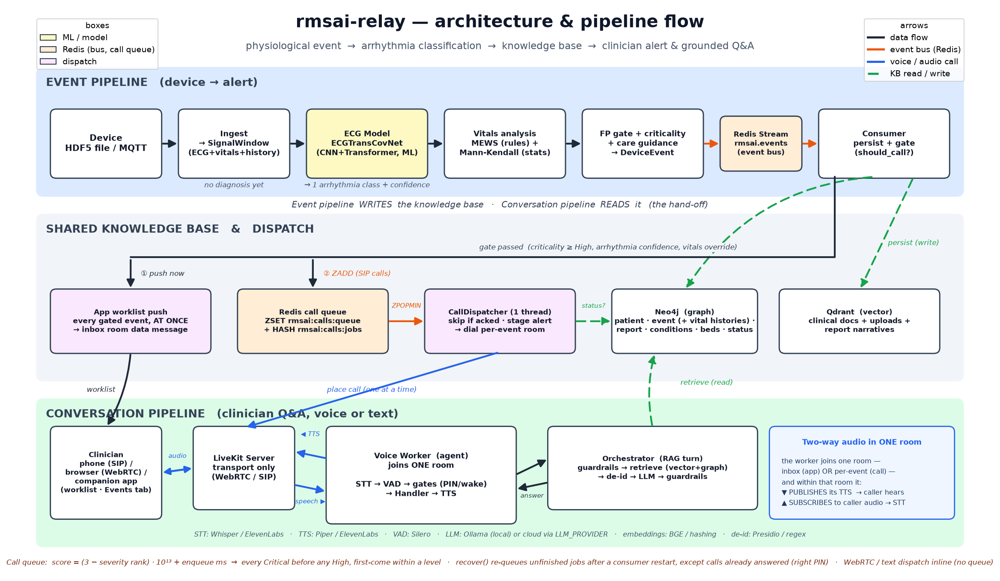
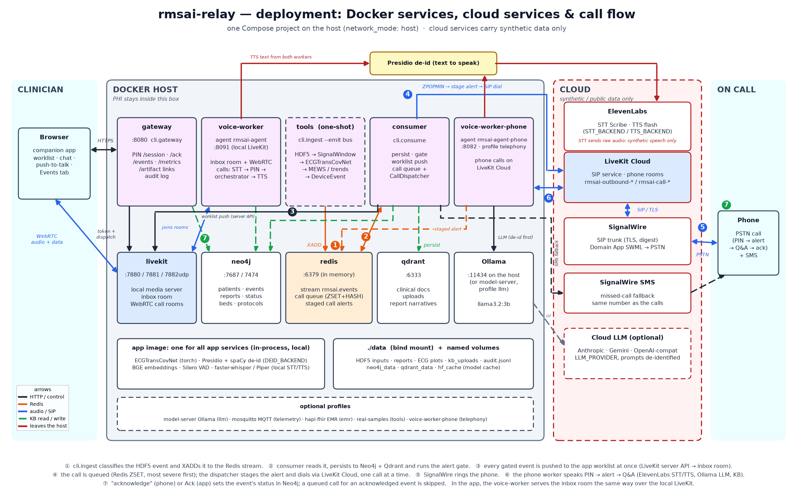
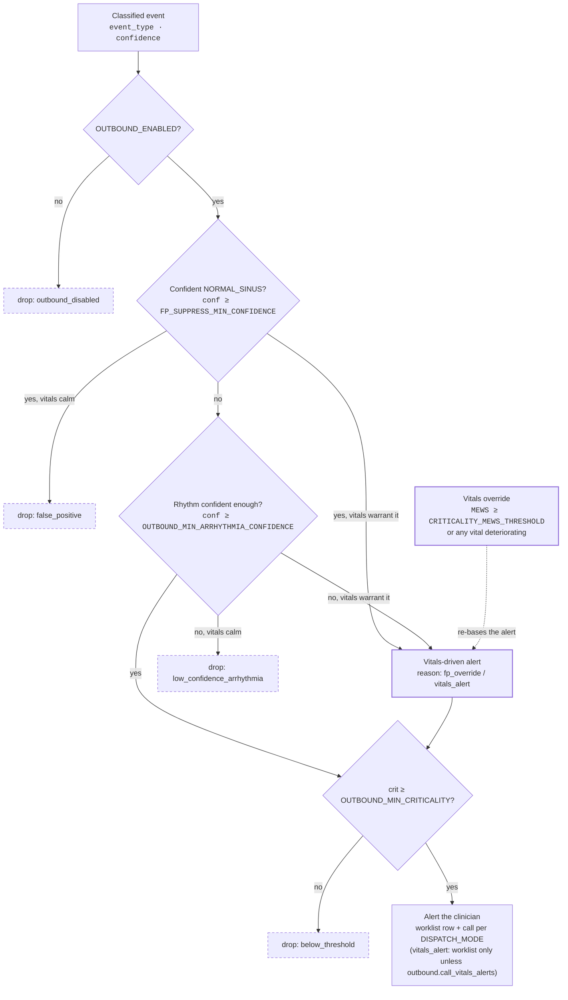
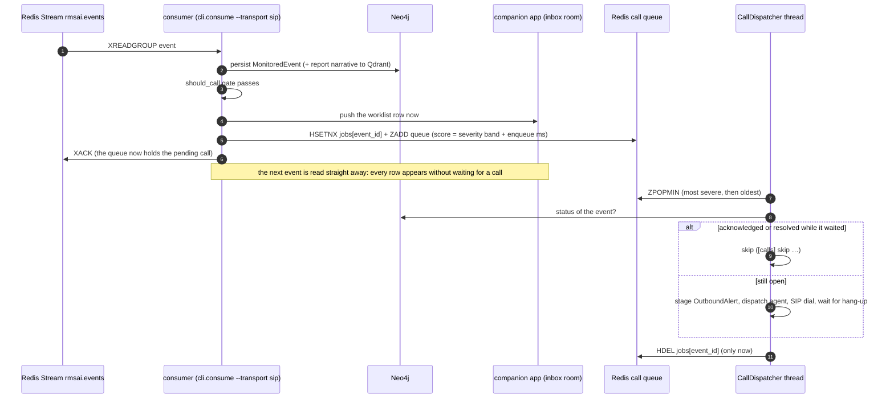
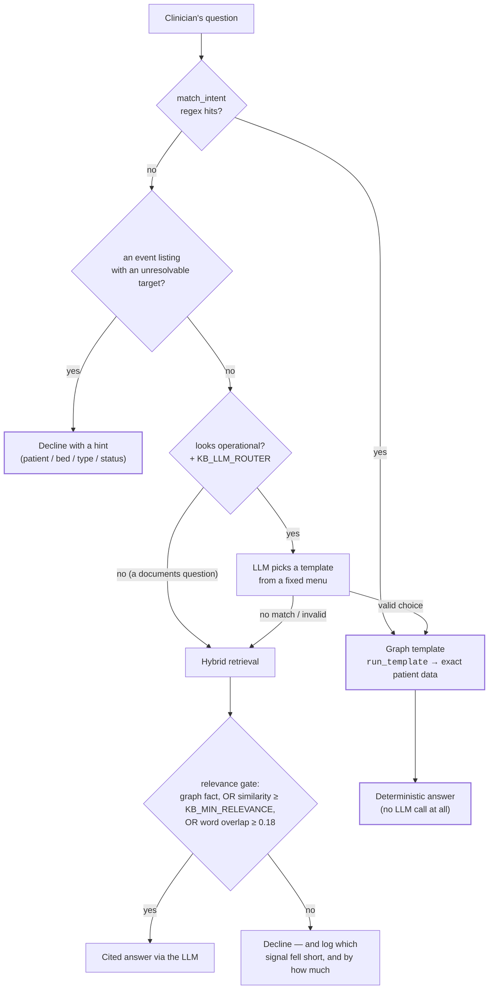
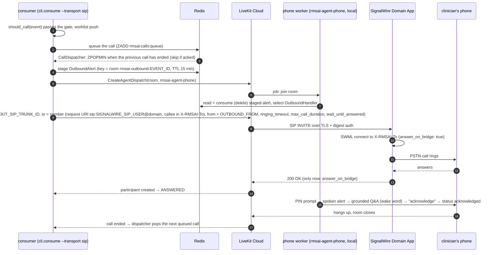
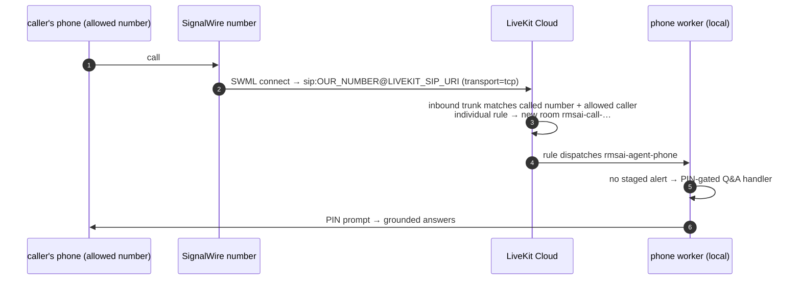

# Architecture — control flow, data flow & models

A plain-language map of how `rmsai-relay` works end-to-end: what runs when the ECG model is invoked,
how the LLM answers questions, how the voice pipeline speaks, and which model sits where. For the
phase plan, contracts, and config keys see [README.md](README.md).



*The diagram is generated: `uv run python docs/make_arch_diagram.py` rewrites `architecture.png`.*

**What runs where:** the Docker services, the cloud services (LiveKit Cloud, SignalWire,
ElevenLabs), the Presidio guard in front of cloud TTS, and the numbered event → worklist →
phone-call path.



*Generated by `uv run python docs/make_deploy_diagram.py`.*

## The big picture: two pipelines

The system is **two separate flows** that meet at the databases:

1. **Event pipeline** (machine → alert): a device signal arrives, the ECG model classifies it, it's
   persisted, and *if it's clinically significant* a call is placed. **No human involved yet.**
2. **Conversation pipeline** (human ↔ knowledge): a clinician on a phone/browser asks questions;
   answers are grounded in exactly what the event pipeline saved.

The two never call each other directly — they hand off through **Neo4j** (graph) and **Qdrant**
(vector). The event pipeline *writes* them; the conversation pipeline *reads* them.

**Where Redis fits (partial decoupling).** The *knowledge* hand-off is via the databases above; Redis
adds **asynchronous / cross-process** decoupling at three specific seams:
- **Event bus** (Redis Stream `rmsai.events`) — *within* the event pipeline: the producer
  (`cli.ingest --emit bus`, `XADD`) is fully decoupled from the consumer (`bus_consumer`, which
  drains, persists, and dispatches). Producer and consumer run independently.
- **Call queue** (sorted set `rmsai:calls:queue` + hash `rmsai:calls:jobs`) — *within* the consumer,
  on the SIP transport: the worklist push happens at once, while phone calls wait here and are placed
  one at a time, most severe first. A stream can't do this, because a stream is strictly FIFO.
- **OutboundAlert store** (Redis key `rmsai:outbound_alert:{sid}`, TTL) — *between* the pipelines:
  the consumer that places a call writes the "who/why we're calling" context; the **voice worker is a
  separate process** and reads it on joining the LiveKit room. With the call queue it is written at
  dial time, not when the event arrives, so a call that waited never finds it expired.

Everything else is synchronous: a single Q&A turn calls the orchestrator **in-process**, and the deep
knowledge lives in Neo4j/Qdrant — so the pipelines are **partially** decoupled via Redis, not fully.

```
  EVENT PIPELINE  (device → alert)                    CONVERSATION PIPELINE (clinician Q&A)
  ─────────────────────────────────                   ──────────────────────────────────────
  HDF5 file / MQTT                                     caller audio ─► STT ─► text
        │  ingest/                                            │ (Whisper or ElevenLabs)
        ▼                                                     ▼  VAD (Silero) marks end-of-speech
  SignalWindow (ECG + vitals + history)                PIN gate (no PHI until authenticated)
        │                                                     │
        ▼  inference/                                         ▼
  ECG model .predict() ─► (event_type, confidence)     Handler  ("the LLM node", but really…)
        +  Vitals → MEWS score + trends                       │
        +  FP gate / criticality                              ▼
        ▼                                              Orchestrator (one turn):
  DeviceEvent (+care guidance +markdown report)          guardrails → retrieve (RAG) → de-id
        │                                                  → LLM generate → guardrails
        ├─► Neo4j  (graph: who/what/when) ◄──────────────────┤  reads the SAME databases
        ├─► Qdrant (vector: report text)  ◄──────────────────┤
        ▼                                                     ▼
  should_call?  ──yes──┬─► app worklist push (at once) answer text ─► TTS ─► audio to caller
   (criticality,       │                                               (Piper or ElevenLabs)
    confidence,        └─► call queue (Redis ZSET, most severe first)
    vitals override)         └─► CallDispatcher: one call at a time ─► SIP dial / SMS fallback
```

---

## Pipeline 1 — from device signal to a phone call

**Step 1 · Ingest** (`ingest/`). A physiological event arrives as an **HDF5 file** or an **MQTT**
message and is normalized into a `SignalWindow` — raw ECG samples, vitals (HR, BP, SpO₂, RR, temp),
patient history, and window geometry. There is deliberately **no diagnosis yet** (a frozen-contract
rule: the reader never guesses `event_type`). The reader accepts both the simulator's layout and
ecg_sigma real-ECG HDF5 (metadata as datasets or attributes). `cli.ingest --dir` ingests every
`*.h5` in a folder and, when events carry a ground-truth label, prints a scored accuracy summary
(`"model": "stub"` warns loudly if no checkpoint loaded).

For real ECG, `cli.real_samples pick` (`ingest/real_samples.py`) curates small labelled sets from an
ecg_sigma `ecgpkg` **test split** (subjects the model never trained on) into `data/real/`, re-keying
each patient to a `PT9#####` pseudonym. It refuses a package that isn't the checkpoint's training
package. Runbook: [`DEMO.md`](DEMO.md).

**Step 2 · The ECG model runs** (`inference/ecg_model.py`). This is the one real neural network:
- **Model:** `ECGTransCovNet` (the "ECG_TransConv" model, vendored from `ecgtranscnn`) — a PyTorch
  CNN + Transformer, loaded from one `.pt` checkpoint or several as a softmax-averaging ensemble
  (`ECG_CHECKPOINTS`; the real-ECG `models/real_v2` 5-fold release is the recommended artifact).
- **What it does:** `predict(window)` runs the upstream preprocessing → the network → `softmax` →
  `argmax`, yielding **one arrhythmia class** (e.g. `ATRIAL_FIBRILLATION`, `NORMAL_SINUS`) plus a
  **confidence** in `[0, 1]`. The vocabulary is 16 names; the *head* is whatever the checkpoint
  carries and is read from it — `real_v2` predicts 13 of the 16, the simulator checkpoints all 16.
- If a checkpoint is missing, or its head/leads do not match this repo, it falls back to
  `StubECGModel` so everything downstream still runs. See `inference/README.md` for the input
  contract and the per-class reliability caveats.

**Step 3 · Vitals + false-positive gate** (`inference/pipeline.py`). Separately — and **not ML** — the
pipeline computes the **MEWS** score (Modified Early Warning Score: a **rule-based clinical rubric**,
a fixed points table over the vitals) and per-vital **Mann-Kendall trends** (a **classical statistical
test** for a monotonic trend, yielding a p-value — nothing trained or learned). A trend only counts as
*deteriorating* when it is also clinically significant: the change over the window reaches the
hospital's `min_change` and the latest reading is outside the vital's normal range, moving away
(`common/vitals_trends.py`; README, "Vital trends"). Then the FP gate: a *confident*
`NORMAL_SINUS` (≥ `FP_SUPPRESS_MIN_CONFIDENCE`) is flagged a **false positive**. The output is a
`DeviceEvent` = the window + predicted type + confidence + MEWS + criticality + care guidance + a
markdown report.

**Step 4 · Persist** (`orchestrator/bus_consumer.py`). The event is published to a **Redis stream**
(the bus); a consumer writes it to:
- **Neo4j** (graph): `Patient → HAD_EVENT → MonitoredEvent → HAS_REPORT`, plus conditions, beds, and
  action items — the "who / what / when / relationships" store.
- **Qdrant** (vector): the report narrative is embedded and stored for semantic search, alongside the
  clinical corpus. Embeddings come from **BGE** (`bge-small-en-v1.5`, the `rag` extra) or a
  deterministic **hashing** embedder for offline/test runs. The choice is not cosmetic: only BGE
  separates on-topic from off-topic questions by score, which is what lets the relevance gate answer
  a reworded question instead of declining it. The collection's vector dimension (384 vs 256) is the
  only fingerprint of which embedder built it, so switching requires a rebuild.

**Step 5 · The call decision** (`should_call`, `orchestrator/outbound_flow.py`) — a pure gate. Its
thresholds are **per hospital** (`config/hospitals/<HOSPITAL_ID>.yaml`, sections `escalation:` and
`outbound:`; README, "Per-hospital configuration"); the names below are their environment overrides:
1. `OUTBOUND_ENABLED` must be on.
2. **Criticality** ≥ `OUTBOUND_MIN_CRITICALITY` (default `High`). Criticality is the more severe of
   the arrhythmia class and the MEWS risk, escalated to at least `High` for any real arrhythmia,
   high MEWS, or a deteriorating trend (`common/criticality.py`).
3. **False-positive gate**: a confident `NORMAL_SINUS` does not call…
4. **Arrhythmia-confidence gate**: …and a *non-normal* prediction is only asserted **as a rhythm**
   when confidence ≥ `OUTBOUND_MIN_ARRHYTHMIA_CONFIDENCE` (default `0.60`) — a low-confidence
   arrhythmia is likely a misdetection.
5. **Vitals override**: a deteriorating patient (MEWS ≥ threshold or a deteriorating trend) alerts
   **regardless of the false-positive gate** — bad vitals beat a confident `NORMAL_SINUS`. Vitals
   never raise the confidence bar (they cannot make an uncertain classification true), but they do
   change the **basis** of the alert instead of being ignored: an uncertain rhythm on a deteriorating
   patient is reported as a **vitals-driven alert** naming the vital, with the rhythm marked
   unconfirmed. Only an uncertain rhythm on a patient whose vitals are unremarkable is withheld — and
   even then the event is persisted and answerable in chat.

`common.criticality.alert_basis` is the single source of truth for that distinction; every surface
(worklist row, spoken call alert, console) leads with what it returns, so no surface asserts a rhythm
the classifier could not stand behind.



Dropped events are still **persisted** — the drop withholds the alert, not the data. A rendered
version of this flow, with the measured per-vital numbers behind the override, is in
[`docs/alert-gate.html`](docs/alert-gate.html).

If the gate passes, the consumer dispatches per `DISPATCH_MODE`: it pushes the event to the
**companion app** worklist (`app`), and/or places a **LiveKit** outbound call (SIP phone or WebRTC
room) or sends an SMS (`call`). If a voice call goes unanswered after its retries and a notifier is
configured (`--notifier signalwire`; `simulated` sends nothing and records `sms_simulated`), the alert is texted instead
(`run_outbound(fallback_notifier=)`): delivered keeps the event `reported`, otherwise it is
`notify_failed`. SIP dials go to the telephony LiveKit (`Config.telephony()`; see *Telephony split*
below). The event is **always persisted**; the gate governs the *dispatch* (worklist push and call).
A `vitals_alert` (uncertain rhythm, vitals carry it) goes to the worklist only, unless the hospital
sets `outbound.call_vitals_alerts: true` (default `false`).

**Phone calls queue; the worklist doesn't wait.** On the SIP transport a call blocks until the
clinician hangs up, so the consumer no longer places it inline. It pushes every gated event to the
worklist as soon as it arrives, then queues the call (`orchestrator/call_queue.py`). The queue is a
Redis sorted set `rmsai:calls:queue` plus a job hash `rmsai:calls:jobs`, ordered highest criticality
first and first-come within a level. One `CallDispatcher` thread places the calls one at a time
(`bus_consumer.run_queued_call`):
- It skips an event that was acknowledged or resolved while it waited.
- It stages the spoken alert at dial time, so a call that waited never finds it expired.
- A job leaves the hash only when its call has finished, so a consumer restart re-queues an
  unfinished call (`CallQueue.recover`).

WebRTC and the text channel never block, so they dispatch inline as before.



A job leaves the hash only after its call is over, so a consumer that dies mid-call re-queues it
on start (`CallQueue.recover`). A failing call is logged and dropped, never retried forever; the
retries and SMS fallback inside one call still apply. The demo Redis keeps no snapshot
(`--save ""`), so the queue survives a **consumer** restart but not a Redis restart or
`make docker-down`. The events themselves are safe in Neo4j; only their pending calls are lost.

**One definition of "pending".** An event is *pending* when it was **alerted** (`alert_gate`) and is
not acknowledged or resolved (`kb.graph.events.is_pending`). An event that was never alerted is
*withheld*, not pending. `list_events` is the one query over every stored event, filtered by
patient, bed, type, status, criticality and time. It backs:
- the app's **Events** tab (`POST /events`);
- the worklist backfill on login (`status=pending`);
- `cli.events`;
- the voice/chat event listings (Pipeline 2).

So every surface shows the same rows.

Each persisted event also records **why** it was or wasn't dispatched (`orchestrator/explain.py`:
every rhythm/vitals/criticality trigger, one headline), its **data source** (`SignalWindow.provenance`),
the **model** (`DeviceEvent.model_id`), what was **delivered**, and, for labelled data, the
**outcome** against the ground truth (`inference/metrics.py`). These feed the consumer's `[event]` log
line, `cli.model_perf` and the app's Events tab ("Labelled only" mode adds the per-model summary). Ground truth stays evaluation-only; the
clinical condition link is always the prediction.

---

## Pipeline 2 — the voice / chat conversation

Runs in the **LiveKit agent worker** (`voice/livekit_agent.py`). LiveKit carries the audio (WebRTC
for browser, SIP for phone). In split mode (`LIVEKIT_SIP_URL` set) phone rooms live on a second
LiveKit (LiveKit Cloud), reached through the carrier, a native SignalWire SIP trunk. Browser and inbox rooms stay on the local server. One turn, in order:

1. **Caller speaks** → audio streams into the LiveKit room.
2. **STT** (speech → text). Swappable via `STT_BACKEND`: self-hosted **faster-whisper** (`base.en`)
   or cloud **ElevenLabs Scribe**.
3. **VAD** (**Silero**) detects end-of-speech so the turn is complete.
4. **Wake-word gate** (follow-ups only): after the first alert, an audio turn must open with
   "hey vios" — unless `AUDIO_WAKE_REQUIRED=false`. The companion app's push-to-talk bypasses this.
5. **PIN gate**: no patient data is spoken until the caller authenticates (fail-closed).
6. **The Handler is "the LLM node" — but it is not an LLM.** LiveKit's `AgentSession` pipeline
   expects an LLM step; a **stub LLM** satisfies that gate, but `llm_node` is overridden to call our
   `Handler` → the **orchestrator** instead. The reasoning is our RAG orchestrator, not a raw model.

**Inside the orchestrator turn** (`orchestrator/orchestrator.py`, `handle_turn`):
1. **Input guardrail** — refuse unsafe / out-of-scope requests *before* any retrieval or model call.
2. **Route the question** — three paths, cheapest first, because they answer very differently:



   A **graph template** answers from Cypher with no model in the path — `_answer_operational`
   renders the rows directly, so "what were the vitals at that event" cannot be paraphrased away.
   The **LLM router** (`kb/graph/llm_router.py`) exists because the regexes only fire on phrasings
   someone anticipated; it picks a *name* from a fixed catalogue and never supplies a patient or
   event id (those come from session scope), so a hallucinated identity cannot reach a query.
   It is off by default (`KB_LLM_ROUTER`) — it costs one model call (~6s on `llama3.2:3b`, warm).

   **Event listings are verifiable.** Questions that list events by patient ("this patient", a PT
   number), bed, event type or status ("unacknowledged", "acknowledged", "withheld"), optionally
   "in the last N hours", resolve to the `event_history` template. It is backed by `list_events`,
   the same query as the app's Events tab and `cli.events`.
   - The answer always states its filter: "2 pending (unacknowledged) events on bed Unit1-Bed02 for 1 patient: …".
   - Text answers give each event's short id.
   - In the app chat the worker also publishes the filter (`type:"events_filter"`), and the app
     shows a button that opens the Events tab with the same rows.
   - A listing whose target can't be resolved ("events for Mr Smith") is **declined with a hint**,
     never passed to the LLM router or the KB model.
   - `cli.events --ask "<question>"` shows which query and parameters a question resolves to, the
     rows, and the exact answer.
3. **Retrieve (RAG)** via `HybridRetriever`: a **vector** search over Qdrant (*Retrieved passages*)
   **plus** a **graph** query over Neo4j (*Known relationships*). Two separately-labelled,
   separately-cited blocks (`RetrievalResult`) — no cross-block re-ranking. The corpus is the
   committed `docs/*.md` **plus** whatever was added with `cli.kb_upload` (SOPs, guidelines and
   checklists as PDF or markdown; PDF chunks cite their page). Uploads are copied to
   `KB_UPLOAD_DIR` so a corpus rebuild re-indexes them instead of deleting them.
   The **relevance gate** then decides whether retrieval vouches for itself at all: a graph fact,
   semantic similarity ≥ `KB_MIN_RELEVANCE`, or word overlap ≥ 0.18 — any one suffices. The two
   text signals fail in opposite directions (similarity survives rewording but needs
   `EMBEDDER=bge`; word overlap is the only signal the hashing embedder has), and when neither
   vouches the decline says which number fell short of which threshold.
4. **De-identify** the retrieved context (Presidio or regex, `DEID_BACKEND`) so no name/PHI reaches
   the model.
5. **LLM generate**: the prompt goes to the `LLMProvider`, always wrapped in `DeidentifyingLLM`:
   `EchoLLM` (the code default, `LLM_PROVIDER=echo`, deterministic and offline), self-hosted
   **Ollama** `llama3.2` (`LLM_PROVIDER=ollama`, the only option for real PHI), or a cloud model for
   synthetic data: `anthropic`, `gemini`, or any OpenAI-compatible API (`openai`). An unrecognised
   `LLM_PROVIDER` is an error at startup.
6. **Output guardrail** → the final answer text.

**Back to voice:**
7. Answer text → **TTS** → audio to the caller. Swappable via `TTS_BACKEND`: **Piper** (self-hosted)
   or **ElevenLabs**. Before *cloud* TTS the text is de-identified again (defense in depth), and
   machine tokens are normalized (`speakable`, `voice/adapters.py`) so `NORMAL_SINUS` is spoken as
   "normal sinus", not letter-by-letter with the underscore.
8. Saying **"acknowledge"** flips the event's status in Neo4j — closing the outbound loop.

Two shortcuts reuse the same machinery:
- **Speak-on-select** (companion app): selecting a worklist row sends a `/select` control message;
  the worker speaks that event's stored `Report.summary` via TTS (`INBOX_SPEAK_ON_SELECT`). The
  app's header toggle mutes it, and it's muted by default in `app+call` mode (the gateway's
  `/session` returns `speak_on_select`), so a clinician on the phone alert doesn't hear the event
  twice. A muted selection is sent as `/select-silent <id>`: the chat is scoped the same way, but
  nothing is spoken and no TTS runs.
- **Text chat**: a typed question runs the same orchestrator turn and returns a **typed** answer (no
  STT/TTS). Typed turns are never wake-word gated.

### The voice worker — what joins the room

`cli.voice_worker` → `voice/livekit_agent.py` is a long-running **agent-worker process**, separate
from the LiveKit server. The split of responsibility is the key idea:
- **LiveKit server** (`:7880`) = **transport only** — it moves audio/data packets between
  participants (WebRTC for browser, SIP for phone). It knows nothing about ECG, PINs, or the KB.
  (In split mode the phone worker's server is the LiveKit Cloud project instead.)
- **The worker** = the **intelligence** — it joins a room *as a participant* and runs the whole
  `STT → gates → Handler/orchestrator → TTS` loop for that call. It is what listens, thinks
  (grounded in the KB), and speaks.

**Lifecycle:** start → connect to LiveKit + register as agent `rmsai-agent` → **wait** → a dispatch
arrives for a room → **join** it (`ctx.connect`) → run the `AgentSession` job for the whole call →
cleanup → back to wait. One process serves **many rooms over its lifetime**; because it registers
under a name it uses **explicit dispatch** — it only joins rooms it is told to (the gateway on
`/session`, the consumer per outbound event, `cli.call`, `cli.livekit_token`, or `cli.dispatch`),
never auto-joining.

A second instance with `VOICE_WORKER_ROLE=phone` (compose `voice-worker-phone`, `make phone-up`)
registers on the **telephony** LiveKit as `rmsai-agent-phone` (`worker_config`). There, the SIP
**individual dispatch rule** created by `cli.sip_setup` requests it into every inbound call room. It is
refused in single-server mode, where the app worker already handles calls.

**Process vs. job — what is "always on" and what is per-event.** Distinguish the two:
- The **worker process** (`cli.voice_worker`) is the single, **always-on** host. It registers once and
  waits; it is *not* per-event and only dies if you stop/restart it.
- A **job** is one room's session. When a room is dispatched, the framework runs that room's
  `_entrypoint` in its **own prewarmed subprocess** (`_prewarm` loads the VAD, embedder,
  de-identifier and STT/TTS there and warms Ollama; one idle process is kept ready,
  `IDLE_PROCESSES`); the job joins the room, runs the loop, and exits when the room ends. A second
  concurrent call takes the slower cold path while a replacement process warms.

A job's lifespan therefore equals its **room's** lifespan:

| Room | Job (the per-room "instance") |
|---|---|
| **per-event outbound** (`rmsai-outbound-<event_id>`) — ephemeral, closes when the call ends | **created on dispatch, torn down when the call ends** |
| **companion-app inbox** (`rmsai-inbox-<hospital>`) — persistent while the app is connected | **long-lived** — stays as long as the inbox room/app session exists |
| **phone call** (`rmsai-call-<id>`: on-demand `cli.call`, or an inbound call-in `rmsai-call-…` named by the dispatch rule) — ephemeral | **created on dispatch, ends with the call** |

So there is **no separate "shared worker" vs "per-event worker" as distinct processes** — it is one
always-on process running many jobs (one per room), each in its own subprocess: an ephemeral room ⇒ a
short job, a persistent room ⇒ a long job. Restarting the worker process kills **all** its jobs
(including the long-lived inbox job), which is exactly why the persistent inbox room needs a fresh
dispatch after a restart — the auto-redispatch / `cli.dispatch` that closes that gap.

On joining, `_entrypoint` reads the room name and picks the Handler:
- `rmsai-inbox-*` → `InboxHandler` (companion app: push-to-talk, selection-scoped Q&A, speak-on-select);
- an outbound event room with a staged `OutboundAlert` in **Redis** → `OutboundHandler` (speaks that
  event's alert after the PIN, then Q&A + acknowledge);
- otherwise → inbound KB Q&A. This is what `rmsai-call-*` phone rooms get: no staged alert ⇒ the
  PIN-gated Q&A handler.

That second bullet is the seam where the **event pipeline hands off to the conversation pipeline**: the
consumer placed the call and wrote *why* into Redis; the worker — a **separate process** — reads that
alert on join and voices the right event.

**Two-way audio, one room.** Within **whichever single room it joins**, the worker is a **full
bidirectional participant** — it does *not* listen in one room and speak in another. In that one room
it both:
- **subscribes** to the human's audio track (their speech) → feeds **STT**, and
- **publishes** its own audio track (**TTS**) → the human hears the answer.

This dual behavior is identical in both room types, they are just independent conversations:
- **inbox room** (`rmsai-inbox-<hospital>`) — subscribes to the app user's push-to-talk audio **and**
  publishes TTS, both here;
- **per-event room** (`rmsai-outbound-<event_id>`) — a *separate* worker job subscribes to the remote
  clinician's speech (phone via SIP or browser via WebRTC) **and** publishes TTS, both here.

So "the worker delivers TTS to the event's room and subscribes to it for the caller's speech" is
correct — and the *same* two-way exchange happens in the inbox room for the app. (The worker can serve
both at once, as two independent jobs; each is a self-contained two-way session in its own room.)

### Room models: inbox vs outbound, and SIP vs WebRTC

There are two shapes of room. The worker and its loop are **identical** in both — only *how the human
gets into the room* differs.

| | Companion-app **inbox** | **Outbound event call** |
|---|---|---|
| Room name | `rmsai-inbox-<hospital_id>` — **one persistent room per hospital** | `rmsai-outbound-<event_id>` — **one room per event** |
| Lifespan | long-lived; many events flow through it | ephemeral; created for the alert, closes when the call ends |
| Which event | selection scopes it (`/select`) | the room *is* the event; its alert is staged in Redis |
| Transport | WebRTC (browser) | **SIP (phone)** or **WebRTC (browser)** |

The **two outbound transports** both use the same per-event room (`rmsai-outbound-<event_id>`) and then
run the same worker loop — they differ only in **who initiates the audio connection**:

- **SIP (phone) — relay-initiated.** Selected by `cli.consume --transport sip` (the compose consumer
  defaults to `webrtc`). The dial and the agent dispatch both go to `config.telephony()`. The dial is
  `LiveKitCaller.place_call` → `create_outbound_sip_call` through the outbound trunk
  (`LIVEKIT_SIP_TRUNK_ID`) to **SignalWire**. The destination is `--number`, else `OUTBOUND_CALL_NUMBER`. Full flow: *Telephony split* below.
- **WebRTC (browser) — clinician-initiated.** The relay only **stages the alert and prints a join
  link/token** (or pushes it to the app); the clinician clicks and joins from a browser. No dialing,
  no trunk, no phone (`caller_factory` is a no-op `SimulatedCaller`).

So your intuition is right: **each outbound event gets its own room** — that per-event room carries
that event's staged alert, whether the human arrives by SIP or WebRTC. The companion-app **inbox is the
exception**: one shared, persistent room where selection picks the event. (The static `rmsai-outbound`
room, `LIVEKIT_SIP_ROOM`, is only the *default* when a `LiveKitCaller` is built without an explicit
room — the standalone `cli.outbound` path, one call at a time; the bus consumer always uses a per-event
room for both transports.)

**The companion app is entirely single-room** — it uses only `rmsai-inbox-<hospital_id>` for
everything, and never joins a per-event room:
- **Worklist (listing)** is **pushed live, plus a backfill on login** (`POST /events`,
  `status=pending`): the consumer publishes each critical event as a data
  message *directly via the LiveKit server API* (`live/inbox.py`, `RoomService.send_data`) — pushed by
  the **relay, not the voice worker**, so the list populates even with no worker present. The app's
  `DataReceived` handler feeds a pure reducer (`applyMessage`) that builds the table; acknowledgements
  arrive the same way as `type:"status"` messages.
- **Selecting a row does NOT join that event's room.** It sends a `/select <event_id>` control message
  on the chat topic in the *same* inbox room, which scopes the worker's conversation to that event.
  Chat answers (text stream), the spoken summary / voice answers (the worker's audio track), and inline
  artifacts (`type:"show"` + scoped HTTP token links) all flow inside that one room.

### Notification vs. outbound call — why per-event rooms exist

A natural question: if events are already posted to the app's inbox room, why do per-event rooms exist
at all? Because **posting a notification and placing a call are two different jobs**:

| | Inbox data message | Per-event outbound room |
|---|---|---|
| What it is | a **notification** (metadata) | a **live audio call session** |
| Goal | "show this in the worklist" | "**reach** a clinician who isn't watching the app" |
| Mechanism | a `send_data` packet into the shared room | a room the clinician is **dialed into** (SIP) or **joins by link** (WebRTC) |
| Participants | the app (already connected) | the agent worker **+** that one clinician |

For a clinician **using the app**, events already *are* delivered to their room (the worklist), and
voice Q&A happens **in that same room** — no separate room needed. The per-event rooms exist for the
*other* case: **actively reaching a clinician who is not in the app** — ringing their **phone** (SIP)
or sending a **join link** (WebRTC) for a critical event. You cannot "post a data message" to make a
phone ring; a call is a media session that must be *placed*, and it needs a room to live in.

**Who subscribes to a per-event room:** exactly two participants — a private 1:1 call.
1. the **voice worker** (dispatched in; reads the event's `OutboundAlert` from Redis to know what to
   voice), and
2. the **clinician** (their phone bridged in by the SIP trunk, or their browser joined via token).

**Why it can't just reuse the shared inbox room:**
- **Isolation / PHI** — the inbox room is a per-hospital *shared* space; bridging live calls about
  different patients into it would let everyone hear everyone (cross-talk, PHI leakage). Each 1:1 call
  must be isolated.
- **Routing** — the room name *is* the event id, which is how the worker (and the Redis alert) know
  *which* patient/event the call is about. A shared room can't carry that.
- **Lifecycle** — a call is short-lived (ring → answer → alert → Q&A → hang up); a dedicated room gives
  it clean create/teardown, independent of the long-lived inbox room.

**Mental model:** *push a notification to someone already looking* (inbox room) vs. *place a call to
reach someone who isn't* (per-event room). The second fundamentally needs its own isolated media room
per event.

---

### Telephony split — phone calls on a second LiveKit

A LiveKit SIP bridge only places calls into rooms **on its own server**, and the local LiveKit has
no SIP service. So phone calls run on a second LiveKit, a LiveKit Cloud project, while the app inbox,
chat and WebRTC stay local:

```
local LiveKit ── app inbox (rmsai-inbox-*) · WebRTC outbound rooms ── worker rmsai-agent
LiveKit Cloud ── phone rooms (rmsai-outbound-*, rmsai-call-*) ─────── worker rmsai-agent-phone
                 ▲ carrier: SignalWire (native SIP trunk both ways; also the SMS fallback)
shared ── Redis (call queue, staged outbound alerts) · Neo4j · Qdrant · audit log
```

- **`Config.telephony()`** is the config the call paths use (`cli.consume --transport sip`,
  `cli.call`, `cli.outbound --caller livekit`, the phone worker). In split mode it swaps only the
  LiveKit URL/key/secret, the agent name, the worker health port, clears the public URL, and
  disables inbox auto-redispatch.
  With `LIVEKIT_SIP_URL` unset it returns the app config unchanged (single server, as before).
- **The phone worker** (`VOICE_WORKER_ROLE=phone`) also pins `LIVEKIT_URL/API_KEY/API_SECRET` in its
  environment before starting livekit-agents' CLI, because that CLI reads those variables and would
  otherwise register on the local server (`.env`'s values) regardless of `WorkerOptions`.
- **`cli.sip_setup`** provisions the Cloud side idempotently by name, and prints the SignalWire-side
  scripts (`--swml`; with `SIGNALWIRE_SIP_USER` set, the outbound script dials the `X-RMSAI-To`
  header).

| Carrier | Outbound | Inbound | LiveKit objects |
|---|---|---|---|
| **SignalWire** | outbound trunk → Domain App (TLS, digest) → SWML `connect` → PSTN | number's SWML `connect` → inbound trunk (number + allowed callers) | `rmsai-outbound-signalwire`, `rmsai-inbound-signalwire`, individual rule `rmsai-inbound-dispatch-signalwire` |

#### Outbound alert — SignalWire



On failure, `CreateSIPParticipant` raises: a ring timeout, busy, or any SIP error such as
`603 Decline` all map to **NO_ANSWER**. `place_with_retries` re-dials `OUTBOUND_MAX_RETRIES` times (each retry re-stages the alert and
re-dispatches the agent, since the first agent consumed it),
`OUTBOUND_RETRY_DELAY_S` apart; then `run_outbound`'s `fallback_notifier` texts the alert (`reported`
if delivered, else `notify_failed`). A missing trunk or an invalid number is **INVALID**: fail fast,
no retry, no SMS. `cli.call` is the same dial into `rmsai-call-<id>` with nothing staged, so the
worker runs the PIN-gated Q&A.

#### Inbound call-in



- **Status (2026-10-13):** SignalWire outbound works end to end (the account had to leave trial
  mode, and the dial must target the SIP address user, `SIGNALWIRE_SIP_USER`, or SignalWire answers
  `603 Decline`): the phone rings, the PIN is accepted, the alert is spoken and Q&A works, with
  ElevenLabs STT/TTS. `make demo-phone-up` runs event-driven calls through the queue. Call-in is
  verified (2026-10-13). The SMS fallback sends through
  SignalWire, from the number that rang (a test SMS to +91 was delivered on 2026-10-13).
- **Set-up:** [`TELEPHONY_SETUP.md`](TELEPHONY_SETUP.md) (SignalWire) and README § Phone calls.

## The models, at a glance

| Role | Model / tech | Where | Swappable via |
|---|---|---|---|
| **ECG classification** | `ECGTransCovNet` (CNN + Transformer, PyTorch) | `inference/ecg_model.py` | checkpoint; stub fallback |
| **Vitals / severity** | MEWS (rule-based rubric) + Mann-Kendall trends (statistical test) — **no ML** | `inference/`, `common/criticality.py` | — |
| **Embeddings** (vector search) | hashing (default) or **BGE** `bge-small-en-v1.5` | `kb/vector/` | `EMBEDDER` |
| **Call ordering** | Redis sorted set + one dispatcher thread (no model) | `orchestrator/call_queue.py` | — |
| **LLM** (answers) | Echo (code default, offline), **Ollama `llama3.2`** (local), or Claude / Gemini / OpenAI-compatible (synthetic data only) | `common/providers.py` | `LLM_PROVIDER` (`LLMProvider` interface) |
| **STT** (speech→text) | faster-whisper `base.en` or ElevenLabs Scribe | `voice/adapters.py` | `STT_BACKEND` |
| **TTS** (text→speech) | Piper or ElevenLabs | `voice/adapters.py` | `TTS_BACKEND` |
| **VAD** (speech detection: endpointing + barge-in) | Silero | LiveKit worker | — |
| **De-identification** | Presidio (NER) or regex | `common/deid.py` | `DEID_BACKEND` |
| **Graph DB** | Neo4j | `kb/graph/` | — |
| **Vector DB** | Qdrant | `kb/vector/` | — |
| **Voice transport** | local LiveKit (app + WebRTC); a second LiveKit (Cloud) for SIP in split mode; carrier SignalWire (SIP trunk, SWML) | `voice/`, `voice/sip_setup.py` | `LIVEKIT_SIP_URL` |
| **SMS** | SignalWire Messages REST API (stdlib HTTP) | `common/notify.py` | `--notifier` |

---

## Design invariants

- **Self-hosted for PHI, cloud only for synthetic.** Everything that touches real patient data runs
  locally (whisper, piper, ollama, neo4j, qdrant). Cloud models (ElevenLabs, Anthropic/OpenAI) are
  permitted only on synthetic data (hard rules #4/#5). Transport vendors (LiveKit Cloud, the
  phone carrier SignalWire, for calls and SMS) carry live call audio and alert text: in development only synthetic or public data
  may flow through them, and production needs BAAs or self-hosted SIP.
- **One interface per model.** `ECGModel`, `LLMProvider`, `STTAdapter`/`TTSAdapter`, `EventStore`,
  etc. Any single model swaps by config without touching the flow.
- **Redaction by construction.** Patients are referenced by pseudonym everywhere (including logs);
  de-identification runs before every model call and before any cloud TTS, and **fails closed**.
- **Frozen contracts.** `SignalWindow` (no predicted type), `DeviceEvent`, `RetrievalResult` (two
  cited blocks) are defined in `common/` and decouple the stages from each other.
- **Resilience.** Graph traversals and RAG chains tolerate missing nodes / broken chains without
  throwing — a partial KB degrades the answer, it doesn't crash the call.
